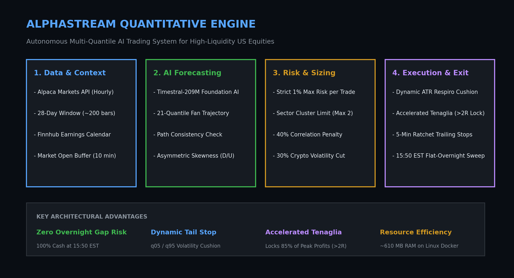
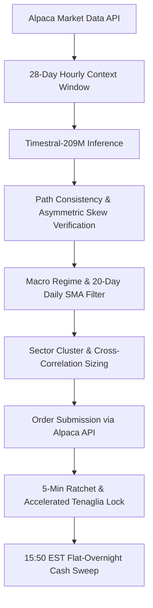

# AlphaStream: Autonomous Quantitative Trading Engine

AlphaStream is an autonomous, production-grade algorithmic trading system tailored for high-liquidity US equities (Nasdaq-100 constituents). Built on top of **LumiBot** and powered by **Mistral's Timestral Foundation Model**, the system pairs multi-quantile probabilistic forecasting with multi-layered statistical risk management and dynamic trade lifecycle control.

---

## Architecture Overview



---

## Key Highlights

- **Foundation AI Forecasting**: Leverages `Timestral-209M` for 21-quantile probabilistic time-series trajectory estimation on hourly bars.
- **Path Consistency Filter**: Validates early forecast trajectories ($t+1, t+2, t+3$) to prevent adverse dip/spike stop-outs before recovery.
- **Asymmetric Skewness Guard**: Calculates Downside-to-Upside quantile tail dispersion ($D/U$) to eliminate fat-tail risk entries.
- **Dynamic Structural Stops**: Adaptive volatility cushions ($ATR$ + quantile boundary $q_{05}/q_{95}$) with active server-side emergency stops.
- **Tenaglia Accelerated Profit Lock**: Ratchet mechanics lock up to 85% of peak gains once a trade exceeds $+2R$ favorable excursion.
- **Flat-Overnight EOD Sweep**: Automatically liquidates speculative positions at 15:50 EST (21:50 CET), eliminating overnight gap exposure.
- **Multi-Factor Risk Engine**: Sector cluster caps, cross-asset correlation penalties, contextual bandit parameter tuning, and Finnhub/Gemini earnings shields.

---

## Timestral-209M Probabilistic Forecasting

Rather than relying on noisy single-point predictions, AlphaStream evaluates the full probability distribution of future price steps across 21 quantiles:


- **Statistical Boundaries**: $q_{05}$ serves as the floor stop for Long entries, while $q_{95}$ bounds Short positions.
- **Trajectory Validation**: Before opening any position, the engine verifies that the immediate steps do not violate risk buffers before reaching target median $q_{50}$.

---

## Dynamic Profit Protection & Lifecycle

Positions are dynamically managed throughout the trading session to lock in gains and prevent round-trips:


- **Market Open Buffer**: 10-minute quiet period (9:30–9:40 EST) to avoid opening-bell whipsaws.
- **Accelerated Tenaglia**: When favorable excursion exceeds $+2R$, trailing stops instantly lock **85% of maximum peak profits**.
- **15:50 EST EOD Sweep**: Closes 100% of open positions flat before the closing bell to ensure zero overnight holding risk.

---

## Trade Decision Sequence



---

## Core Modules

| Module | Primary Responsibility |
| :--- | :--- |
| `timestral_engine.py` | Runs CPU-optimized quantile forecasting with `Timestral-209M`. Extracts median expectations, structural stops, and tail risk asymmetries. |
| `strategy.py` | Orchestrates order flow, macro regime detection, sector limits, correlation-based size adjustments, and dynamic profit locking. |
| `config.py` | Centralized repository of risk constants, sector clusters, watchlist constituents, and operational schedules. |
| `news_guardian.py` | Pre-trade news vetting and earnings blackout enforcement using Finnhub calendars and Google Gemini Flash. |
| `adaptive_learner.py` | Contextual multi-armed bandit tuning parameters such as stop distances, break-even thresholds, and ticker weights based on real trade feedback. |
| `notifier.py` | Sends structured HTML telemetry and trade alerts to Telegram via webhook integration. |

---

## Getting Started

### Prerequisites

- Python 3.10+
- Alpaca Markets Account (Paper Trading credentials)
- Google Gemini API Key (optional for news sentiment veto)
- Finnhub API Key (for earnings calendar checks)

### Local Installation

1. **Clone the repository:**
   ```bash
   git clone https://github.com/your-username/alphastream-quant.git
   cd alphastream-quant
   ```

2. **Configure environment variables:**
   ```bash
   cp .env.example .env
   ```
   Fill in your API keys in `.env`.

3. **Install dependencies:**
   ```bash
   python -m venv .venv
   source .venv/bin/activate  # On Windows: .venv\Scripts\activate
   pip install -r requirements.txt
   ```

4. **Run the bot:**
   ```bash
   python main.py
   ```

---

## Docker Deployment (Headless Server / OMV)

The system includes a production-ready `Dockerfile` and `docker-compose.yml` configured with memory constraints (`mem_limit: 1500m`) for running safely on low-resource Debian/OpenMediaVault servers.

```bash
docker compose up -d --build
```
