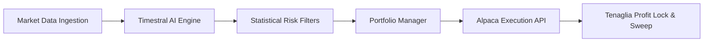

# AlphaStream
## Autonomous Quantitative Trading Engine
### Multi-Quantile Time-Series AI & Systematic Risk Management

*Operating on US Equities (Nasdaq-100)*

---

# Executive Summary

- **Objective**: Fully autonomous, zero-cost paper trading platform designed for systematic edge in high-liquidity equities.
- **Core Engine**: Combines **Timestral-209M** probabilistic time-series forecasting with strict mathematical risk management.
- **Capital Preservation**: Zero-overnight exposure (EOD Cash Sweep), dynamic ATR cushions, and multi-factor anti-concentration guards.
- **Infrastructure**: Lightweight, containerized on Linux/Docker with low memory footprint (~600 MB RAM).

---

# System Architecture Overview

- **Data Layer**: Alpaca Market Data (hourly bars) + Finnhub (Earnings events).
- **Inference Layer**: Mistral Timestral-209M forecasting 21 quantiles over a 6-step horizon.
- **Execution**: LumiBot algorithmic framework with server-side emergency stops.

---

# Timestral Foundation Model Integration

- **Probabilistic Edge**: Rather than single-point price estimates, Timestral outputs 21 quantile trajectories.
- **Tail Identification**:
  - $q_{05}$: Statistical floor (used as dynamic structural stop for Long positions).
  - $q_{50}$: Expected median price trajectory.
  - $q_{95}$: Statistical ceiling (used as dynamic structural stop for Short positions).
- **Lookback Window**: 28 calendar days (~180-200 trading hours) capturing genuine cyclic patterns and regime stability.

---

# Advanced Statistical Filtering

### 1. Path Consistency Check ("Anti-Fossa")
- Tracks the forecasted median trajectory ($q_{50}$) across immediate steps ($t+1, t+2, t+3$).
- Rejects entries if the early path dips or spikes into the stop zone before eventual recovery.

### 2. Asymmetric Skewness Guard
- Evaluates tail asymmetry:
  $$\text{Skewness Ratio} = \frac{q_{50} - q_{05}}{q_{95} - q_{50}} = \frac{\text{Downside Risk}}{\text{Upside Potential}}$$
- **Long Rule**: Rejects trades if Downside exceeds $2.0 \times$ Upside.
- **Short Rule**: Requires Downside to be at least $0.75 \times$ Upside.

---

# Multi-Layered Risk Management

| Layer | Mechanism | Protection |
| :--- | :--- | :--- |
| **Position Sizing** | 1% Capital Risk (Long), 0.5% (Short) | Eliminates account drawdowns |
| **Cluster Limits** | Max 2 positions per sector | Mitigates concentrated tech shocks |
| **Correlation Cut** | 40% size reduction if $\rho \ge 0.65$ | Reduces cross-portfolio co-variance |
| **Volatility Sizing** | 30% reduction on Crypto/Fintech | Tames high-beta noise (MSTR, COIN) |
| **Anti-Exhaustion** | Block entry if $>3.2 \times ATR$ from Open | Prevents buying extended moves |

---

# Trade Lifecycle & Profit Locking

### 1. Market Open Calm Buffer
- Pauses new entries during the first 10 minutes (09:30–09:40 EST) to avoid opening bell whipsaws.

### 2. Accelerated Tenaglia Mechanism
- Once a position achieves $+2R$ favorable excursion, the trailing stop automatically locks **85% of peak profit**.

### 3. Flat-Overnight EOD Sweep
- At **15:50 EST (21:50 CET)**, all open speculative positions are closed flat.
- Guarantees **100% cash overnight**, eliminating earnings gap and weekend risks.

---

# Self-Tuning & Adaptive Learning

- **Contextual Multi-Armed Bandit**:
  - Continuously optimizes stop ratios, ATR multipliers, and break-even triggers based on realized trade outcomes.
- **Ticker-Level Weights**:
  - Dynamically rewards consistent performers with size bonuses while penalizing noisy symbols.
- **News Guardian Shield**:
  - Enforces mandatory earnings blackout windows via Finnhub calendar.
  - Employs Google Gemini Flash for real-time headline sentiment vetoes.

---

# Production Deployment

- **Containerized Stack**: Packaged with Docker Compose on Debian Linux / OpenMediaVault.
- **Resource Constraints**:
  - Hard CGroup limit: `1500 MB` RAM.
  - Active runtime footprint: `~610 MB` RAM on CPU.
- **Real-Time Telemetry**:
  - Instant trade fills, dynamic stop adjustments, and Tenaglia locks pushed to Telegram via automated webhook.

---

# Summary & Future Roadmap

- **Stability**: Robust multi-filter execution tested with zero overnight risk.
- **Next Evolutions**:
  - High-frequency tick-level microstructure confirmation for entries.
  - Multi-asset expansion (Macro sector ETFs and commodities).
  - Model quantization experiments for sub-second inference latency.
